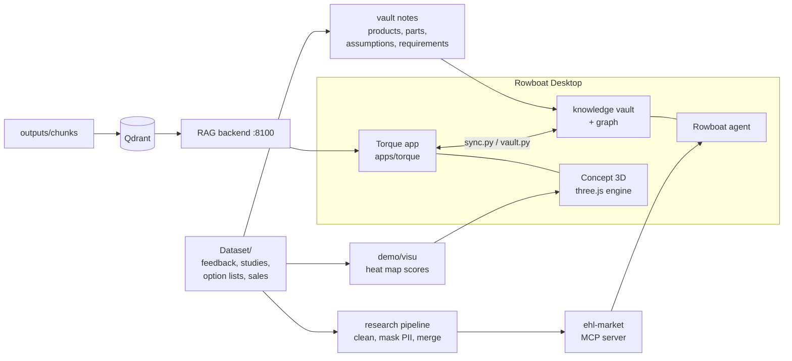

# Torque in Rowboat: an AI product requirements cockpit

EHL Munich 2026 Grand Finale (10–11 Oct 2026, Garching).

Product managers choose what the successor of a car should have. Their inputs are thousands of customer
comments, survey studies, option price lists, sales figures and market research. **Torque** turns these
inputs into a ranked list of purchase drivers and requirements. Every requirement carries its evidence, an
explicit human decision and an append-only audit trail. On a 3D model of the car you can see which parts
customers criticise. Torque runs as an app inside **[Rowboat](https://github.com/rowboatlabs/rowboat)**, the
open-source AI coworker. Rowboat's knowledge graph and agent work on the same data as the cockpit.

**Demo video (83 s):** [docs/media/demo.mp4](docs/media/demo.mp4). It shows Torque in Rowboat, the Concept 3D
heat map, the market MCP in Rowboat's chat, the market map and the Nordi copilot. The voice-over is
AI-generated.

## What the challenge asks for, and where to see it

| Deliverable | In the prototype |
| --- | --- |
| 1. Prototype that processes heterogeneous inputs, derives and prioritises requirements, with human review | **Torque**: *Overview*, *Purchase drivers*, *Simulator*. Inputs: feedback workbooks, customer studies, option lists and sales volumes in `Dataset/`, plus outside market data via the `ehl-market` MCP server |
| 2. Structured list of requirements: ID, description, findings and sources, priority or score, rationale, evidence level, assumptions, decision status | **Rowboat vault** `Requirements/` (one note per requirement, e.g. `R-01 Fast charging`: target, acceptance criterion, assumptions) and **Torque** *Purchase drivers* (score, evidence, quotes with comment IDs). The *Brief* export compiles all of it |
| 3. End-to-end workflow: what the AI does autonomously, where a human must decide | **Torque** *Data and workflow*: every step from ingest to decision, marked "autonomous, logged" or "human". Spec: [docs/deliverables.md](docs/deliverables.md) |
| 4. Audit trail from findings through scoring to the human decision | **Torque** *Audit trail* (append-only: content, score, priority, evidence and status changes with actor, time and reason) and *Review log*. Decisions are written back to Rowboat notes (`Purchase Drivers/`) |

## How it fits together



- **Rowboat** (unmodified, upstream commit `72e9d8c`) hosts Torque as an app, provides the model the user
  configured (`llm` capability) and keeps the knowledge vault: Markdown notes linked into a graph.
  [Why Rowboat](docs/why-rowboat.md)
- **Torque** (`demo/torque/`) is the decision cockpit. It is a single-file web app; its source is
  `demo/torque/dist/index.html`. Two syncs keep it and the vault in step: decisions go to notes, and
  notes go to the cockpit.
- **Concept 3D** (`demo/visu/`, React Three Fiber + three.js) colours the parts of the successor car by
  customer sentiment and takes design prompts. [The 3D engine](docs/3d-engine.md)
- **Nordi**, Torque's copilot, answers from the data on screen and, with the RAG backend, from the indexed
  source documents (`app.py`, `src/rag_backend/`, Qdrant).
- **ehl-market** (`market/`) is an MCP server for Rowboat's agent: sources, live World Bank, Eurostat and
  NHTSA data, correlation tools.

## Run it

You need Git, Python 3.12, Node.js 22 (or 24.15+), pnpm 10 and, for the RAG, Docker Desktop. The installer
checks these and tells you how to install what is missing (winget on Windows, Homebrew on macOS).

```bash
python scripts/install.py --check
```

```bash
python scripts/install.py
```

The installer does all of this and is safe to re-run:

- clones Rowboat (`Flissel/rowboat`, branch `ehl`) next to this repo and installs its packages;
- sets up the market MCP server and the research pipeline;
- writes Torque's customer quotes from `Dataset/`;
- fills Rowboat's knowledge vault and registers Torque as a Rowboat app;
- adds `ehl-market` to Rowboat's `mcp.json`;
- starts Qdrant, asks for `OPENAI_API_KEY` (written to `search/.env`, gitignored) and builds the search index.

Use `--skip-rag` to run without Docker and OpenAI. Nordi then answers from Torque's data only.

The three 3D cars ship with the repo (`demo/torque/dist/visu/models/`), so nothing has to be downloaded.
**One manual step:** start the demo, then add your own model API key in Rowboat → Settings.

```bash
python scripts/install.py --start
```

`--start` launches Rowboat (dev mode), the RAG backend and both syncs. The first build takes a few minutes.
Then open **Apps → Torque**. If you already use Rowboat, the demo keeps its data in `~/.rowboat-ehl`, so
your own `~/.rowboat` stays untouched.

Team members setting up a development PC (forks, work-package branches) use [SETUP.md](SETUP.md) and
`scripts/setup_pc.py` instead.

## Repository

| Path | What |
| --- | --- |
| `demo/torque/` | Torque app: `dist/index.html` (the cockpit), `rowboat-app.json` (app manifest), `sync.py` (cockpit ↔ vault), `make_quotes.py` |
| `demo/visu/` | Concept 3D engine (React Three Fiber, built into `demo/torque/dist/visu/`), heat map scoring (`feedback.py`), vault notes and sync (`vault.py`, `brand.py`, `assumptions.py`, `generate_texts.py`) |
| `research/` | Data pipeline: cleaning, PII masking, clustering, findings |
| `market/` | `ehl-market` MCP server for Rowboat's agent |
| `schema/` | Vault schema: one hierarchy for all business data (`vault-schema.yaml`), and `ehl-schema build \| lint \| migrate` ([spec](docs/superpowers/specs/2026-10-12-vault-schema-design.md)) |
| `app.py`, `src/rag_backend/`, `scripts/` | RAG backend (FastAPI, Qdrant, OpenAI embeddings) and its ingest scripts; `scripts/install.py` |
| `Dataset/` | Challenge data (F70, G60, G68, G70), test data |
| `outputs/` | Preprocessed Markdown, chunks and embeddings for the RAG |
| `docs/` | Deliverables, data pipeline, RAG backend, design specs, and the pages below |

### Nordi voice (mic and read aloud)

In Torque's chat, the **mic** button records a question. Click it again to stop; the question is transcribed and sent to Nordi. The **speaker** button reads answers aloud and stays on until you turn it off. Speech uses Rowboat's voice API if it is configured. Otherwise it uses the RAG backend (`/voice/transcribe`, `/voice/tts`, OpenAI key from `search/.env`), so keep the backend running on :8100. Allow microphone access when asked.

Nordi answers from Torque's dataset numbers plus RAG passages. When the two disagree, the dataset numbers win. Markets where a model is not sold show N/A, and Nordi says when the answer is not in the data.

## Docs

- [Why Rowboat, and how we integrated it](docs/why-rowboat.md)
- [The 3D engine](docs/3d-engine.md)
- [Walkthrough: the app step by step](docs/walkthrough.md)
- [Deliverables](docs/deliverables.md): the challenge brief, requirement and audit-log schemas, and the split between AI and human work
- [Data pipeline plan](docs/data-pipeline-plan.md) · [RAG backend](docs/rag-backend.md) · [Market MCP](market/README.md)

## Team

GitHub: [Flissel](https://github.com/Flissel) (orchestrator) ·
[PedroLemonade](https://github.com/PedroLemonade) · [yunes-mahan](https://github.com/yunes-mahan) ·
[syed-rayyanadil](https://github.com/syed-rayyanadil) · [Paolabeiia](https://github.com/Paolabeiia).
Agent sessions were tracked with [Entire](https://github.com/anthropics/entire).

## Licence

Apache License 2.0, the same licence as Rowboat. See [LICENSE](LICENSE). Third-party material keeps its own
terms; [NOTICE](NOTICE) lists it:

- Rowboat: Apache-2.0, used unmodified.
- three.js, React Three Fiber, drei and React: MIT.
- The 3D car models by Ddiaz Design: CC BY-NC-SA 4.0 (attribution, non-commercial, share alike), included
  unmodified with their `license.txt` in `demo/torque/dist/visu/models/`.
- `Dataset/`: challenge data.

This is a hackathon prototype. It is not affiliated with BMW AG or RowBoat Labs.
